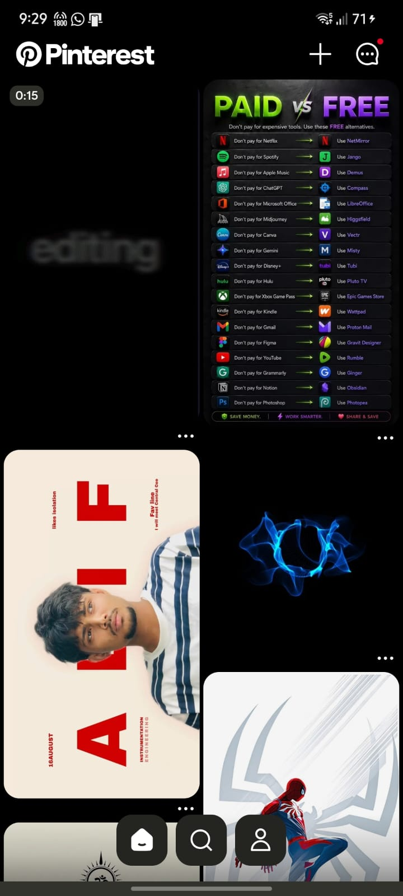
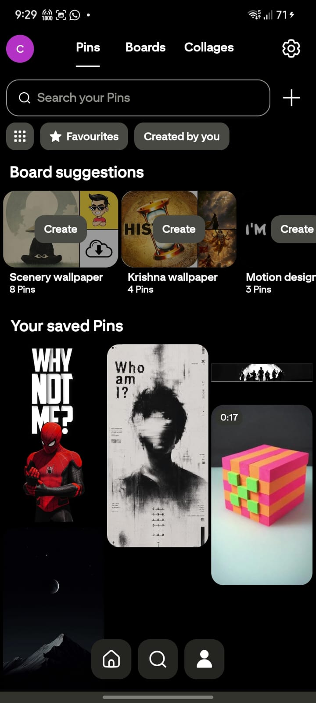

<h1 align="center">Pinterest Ad-Free</h1>

The official Pinterest app (14.41.0), patched to remove ads and add downloads and privacy switches. <b>Unofficial. Not affiliated with, endorsed by or supported by Pinterest, Inc.</b>

<a href="https://github.com/chinmays-tanx09/pinterest-adfree/releases/latest"><b>Download the latest APK</b></a>

  

## What it is

This is Pinterest's own Android app, version 14.41.0, patched with the open-source [HushPinterest](https://github.com/SysAdminDoc/HushPinterest) patches (v0.0.13, GPL-3.0) using the [Morphe](https://morphe.software) patcher. No code of this repository's owner is added; all credit for the patches goes to their authors.

## Features

On by default:
- **No ads**: promoted pins are removed from the feed.
- **Privacy**: analytics disabled, advertising ID hidden, ad-tracking permissions removed, tracking stripped from links.
- **Push notifications** fixed for the patched app.

Available as switches in **Settings → HushPinterest settings** (off until you turn them on):
- Download pins (original-quality image or best video), several pins at once, a whole board, or from the long-press menu.
- Hide AI-labeled pins, shopping/product pins, comments, survey prompts, topic suggestions and search history.
- Original-quality images, AMOLED black theme, show posted date.
- Open links in your own browser, use the system share sheet, no screenshot share menu.
- Keep the Home feed, hide header/navigation/close-up buttons, quieter email reminders, no update nag.

## Install

1. **Uninstall the official Pinterest app first.** This build keeps Pinterest's package name (`com.pinterest`) but is signed with a different key, so Android won't install it over the Play Store version, and it can't sit next to it.
2. Download `Pinterest_AdFree_v14.41.0.apk` from [Releases](https://github.com/chinmays-tanx09/pinterest-adfree/releases/latest) and install it.
3. Sign in with your Pinterest e-mail and password.

Needs Android 10 or newer. The APK is universal (arm64-v8a, armeabi-v7a, x86, x86_64).

## Known limits

- **Not tested on a real phone yet.** The patching finished with every patch applied, but nobody has run this build on a device. Please report problems.
- **"Continue with Google" may not work**: the Google sign-in support patches were not included. Use e-mail and password.
- Don't update it from the Play Store: that replaces it with the official app (with ads). Updates of this build come from this repository.

## Verify your download

Package `com.pinterest`, version 14.41.0 (versionCode 14418020).
Signing certificate SHA-256: `650d96882604cff599411cc260545d7cfcde1edf2681674db16ee7ee8088687a`
APK SHA-256: `b2efb8eecde6c9808176e7dbc83d53cc17f37383a776ed1512b04c6bb63e6de0`

## License and credits

- Pinterest and the Pinterest logo are trademarks of Pinterest, Inc. The Pinterest app is Pinterest's software.
- Patches: [HushPinterest](https://github.com/SysAdminDoc/HushPinterest) by SysAdminDoc, GPL-3.0. The source of the patches used here is the [v0.0.13 source](https://github.com/SysAdminDoc/HushPinterest/tree/v0.0.13). Patcher: [Morphe](https://github.com/MorpheApp).
- See [LICENSE](LICENSE).
